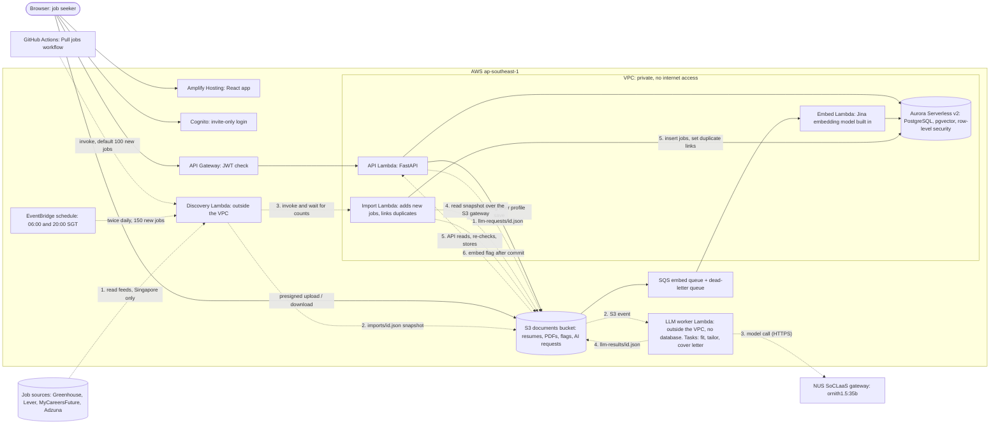

# What runs where on AWS

Job Hunter's staging deployment in `ap-southeast-1` (Singapore): the main cloud features, how they reach the database, and why it is built this way. All of it is defined in Terraform under [`infra/aws/`](../../infra/aws) and released by the **Deploy staging** workflow. Styled copy: [aws-overview.html](aws-overview.html).

## Diagram

Solid lines are request paths. Dashed lines are background paths through S3, a direct Lambda call or a schedule.

The embedding Lambda turns text into lists of numbers (vectors) so jobs and profiles can be compared. It cannot write or judge text. Fit analysis, the AI resume rewrite and AI cover letters use a language model on the school's SoCLaaS gateway, called from one shared LLM worker outside the VPC.

## Features and where they run

| Feature | Runs in |
|---|---|
| Login, hosting, API | Amplify, Cognito, API Gateway (JWT authorizer), API Lambda |
| Resume upload and profile | API Lambda, S3 presigned URLs, Aurora (rule-based parsing) |
| Embeddings and "For you" | S3 flag, SQS, Embed Lambda, Aurora (pgvector) |
| Job discovery | EventBridge schedule or the Pull jobs workflow, Discovery Lambda (outside the VPC), Import Lambda (inside), S3, Aurora |
| Duplicate detection across sources | Import Lambda; `jobs.canonical_job_id` and `also_seen_on` in Aurora |
| Fit analysis | API Lambda, S3, LLM worker (task `fit`; the web app checks back for the result) |
| Resume tailoring | API Lambda (rule-based copy); AI rewrite through the LLM worker (task `tailor`, waits up to 25 s) |
| Cover letters | API Lambda; AI draft through the LLM worker (task `cover_letter`, waits up to 25 s) |

## Fit analysis flow

1. The web app calls `POST /v1/jobs/{id}/fit-analysis`. The API Lambda first checks the monthly AI allowance (free 5, premium 50 jobs).
2. It then adds a pending `fit_analyses` row and writes `llm-requests/<analysis_id>.json` (`task: fit`) to the private documents bucket. The file holds the job text, the job's saved requirements (if any) and the profile evidence, so the worker needs no database.
3. The S3 event starts the **LLM worker Lambda**. One worker handles every AI task, with at most 5 running at once. It runs outside the VPC with no database access and uses the API's container image.
4. The worker calls the SoCLaaS gateway (model `ornith1.5:35b`) over the internet: extract the requirements, judge each one against the profile, and suggest improvements. It writes `llm-results/<analysis_id>.json` to S3. Request and result files are deleted after one day.
5. The web app checks back with `GET /v1/fit-analyses/{id}`. The API Lambda reads the result and **checks it again**: it drops evidence ids and numbers the model made up, and works out the coverage percentage in code. It saves the result in Aurora (visible only to that user) and keeps the job's requirements in `job_requirements`, shared by all users.

## Job pull flow

1. Twice a day (06:00 and 20:00 Singapore time) an **EventBridge schedule** starts the **Discovery Lambda** with a batch of up to 150 new jobs. The **Pull jobs** workflow does the same on demand (default 100). Pausing staging stops both.
2. The Discovery Lambda runs outside the VPC, so it can reach the public job feeds: Greenhouse and Lever boards, MyCareersFuture searches and Adzuna. It keeps Singapore jobs only and writes one snapshot, `imports/<pull_id>.json`, to the documents bucket.
3. It then calls the **Import Lambda** directly and waits. The Import Lambda runs inside the VPC and reads the snapshot over the free S3 gateway endpoint.
4. The Import Lambda mixes the sources so a batch is not all one employer. It adds new jobs up to the batch size and updates the ones already stored, so running a pull again does not add copies. It also closes listings that expired or were not seen for 21 days.
5. **Duplicate detection:** a job found on two sources is linked, not deleted. The employer's own board wins over MyCareersFuture, which wins over Adzuna, and Discover shows the winner once with "Also on …". Two jobs are linked if they share the listing link, or if the employer, title and place match and the descriptions are nearly the same.
6. After saving, the Import Lambda writes an embed flag, and the embed worker gives the new jobs their vectors shortly afterwards.

Adzuna returns only a short snippet of each description, so a job found only there may be too short for fit analysis, which needs at least 120 characters.

## AI resume rewrite and cover letters

These are single short model calls, so the API waits for them inside the request, for at most 25 seconds (the API Lambda stops at 29).

1. **Rewrite:** "Tailor with AI" calls `POST /v1/documents/{id}/tailor` with `mode: ai`. The API makes the rule-based tailored copy first, then sends a `tailor` request with the resume bullets and the job's title, skills and description. It keeps only rewritten bullets that add no new number or name.
2. **Cover letter:** a new AI cover letter sends a `cover_letter` request with the confirmed profile and the job. The letter is kept as written, with a warning beside any number or name that is not in the profile or the job.
3. The month's allowance slot is used only for a usable result. If the worker is slow, fails or has no key, nothing is charged: tailoring returns the rule-based copy, and no AI letter is created.

## What can reach the internet

| Piece | Where | Internet | Database |
|---|---|---|---|
| API Lambda, Embed Lambda, Import Lambda | inside the VPC | no (S3 through the gateway endpoint) | yes |
| LLM worker Lambda | outside the VPC | yes: SoCLaaS and S3 | no |
| Discovery Lambda | outside the VPC | yes: the job sources, S3 and the Lambda API | no |

`LLM_API_KEY` is a GitHub Actions secret; the Deploy staging workflow writes it into the LLM worker's settings, the same way as the database passwords. The model name and gateway URL are Terraform variables.

## Why it is built this way

- **No internet inside the VPC.** A NAT gateway costs money every hour, so anything that needs the internet sits outside the VPC, and anything that only needs the database sits inside.
- **Background work starts with a small file in S3.** The S3 gateway endpoint is free, and an S3 event then starts the worker.
- **Job discovery is split in two for the same reason.** One function can reach the job feeds or the database, but not both. The two halves are joined by a file in S3 and a direct call. (S3 allows only one notification setup per bucket, and the embed and LLM workers already use it.)
- **The embedding model is built into its container image.** It is small, so the embed Lambda needs no network to run it.
- **The language model is hosted by the school.** Amazon Bedrock isn't available on the course AWS account, so the AI features use SoCLaaS and no language model is hosted on AWS. One shared worker makes the calls for every AI feature and has no database access, and the API checks every answer before saving it. A new AI feature adds a task to the worker, not a new Lambda.
- **Slow work does not block the request.** The API Lambda stops at 29 seconds and a fit analysis can take longer, so the API returns at once and the web app checks back for the result.
- **Aurora pauses when idle.** Serverless v2 scales between 0 and 1 ACU (Aurora capacity unit). Only real requests and job pulls wake it.
