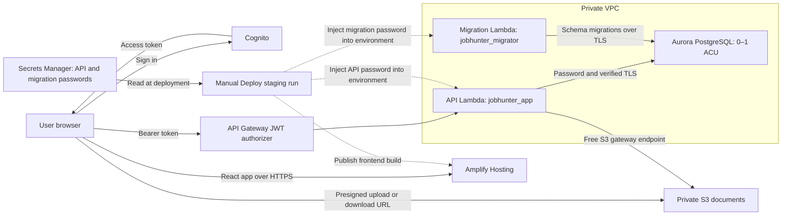

# AWS deployment guide

Updated 9 November 2026. The foundation, backend, website, embedding worker, shared LLM worker and twice-daily job pull are deployed. Singapore (`ap-southeast-1`) is the target region; use Amplify's provided address.

## Architecture and credentials



Solid arrows show application traffic or credential retrieval. Dashed arrows show deployment configuration. The Lambda functions read database passwords from their environment, so they do not contact Secrets Manager at runtime. There is no NAT gateway or paid Secrets Manager VPC endpoint. The master password is used only by the operator bootstrap and is omitted from the normal release path.

| Location | What is stored there | Who can obtain it |
|---|---|---|
| Secrets Manager, Singapore: AWS-managed `rds!cluster-…` secret | Master `jobhunter_admin` password for setup/recovery | Authorised AWS operators; normal release role cannot read this secret |
| Secrets Manager, Singapore: `jobhunter-staging-database-credentials` | Separate passwords for `jobhunter_app`, `jobhunter_migrator` and `jobhunter_embedder` in one JSON secret | Authorised AWS operators and the GitHub release role |
| Each Lambda's environment configuration | That function's own `DATABASE_PASSWORD`, encrypted at rest | Function code and AWS principals with sufficient configuration-reading permissions |
| Terraform state and saved plans | Can contain copies of Lambda environment passwords after refresh | Principals who can read the private state bucket or local plan/state files |
| Git repository and GitHub deployment variables | Architecture, scripts, resource names and secret ARN; no password values | Repository collaborators |

Local development uses the Docker setup and needs no production credentials. Cloud deployment uses **Actions → Deploy staging → Run workflow → main**; ordinary merges do not deploy. Database changes belong in Alembic migrations. Password rotation is separate operator work, not part of normal feature development.

**Trust boundary:** cloning the repository does not grant secret access. However, maintainers who can change and execute the Deploy staging workflow on `main` can potentially retrieve credentials through its AWS role. Treat those maintainers, Lambda configuration readers and Terraform-state readers as trusted secret holders. An ARN is an identifier, not a password.

## Services and why

| Service | Purpose |
|---|---|
| Amplify Hosting | Serve the React build over HTTPS without operating a VM or purchasing a domain. |
| Cognito | Separate user accounts, managed login and access tokens; public browser client with the authorisation-code flow and PKCE (Proof Key for Code Exchange). Team-only access through operator-created accounts; no public sign-up or social login. Website users do not need IAM accounts. |
| API Gateway and Python Lambda | Reuse FastAPI and existing resume/PDF features; request-driven execution with concurrency and request limits. |
| Aurora PostgreSQL Serverless v2 | Keep the existing relational schema, Alembic migrations, pgvector and tenant RLS. Configure 0–1 ACU (Aurora Capacity Unit) and auto-pause after 30 idle minutes for intermittent project use. PostgreSQL compatibility reduces future migration work, but moving to standard RDS still requires data transfer and a tested cutover. |
| Private S3 | Durable uploads and exports across Lambda replacements; versioned files and short-lived signed URLs. |
| Password database authentication | Separate API and migration credentials, retrieved by the release runner and injected into Lambda configuration. No runtime Secrets Manager request or paid interface endpoint. IAM database login isn't available on the course AWS account. |
| GitHub Actions / ECR / Terraform | Test and publish immutable application artifacts; use GitHub OIDC instead of stored AWS keys. Terraform provisions infrastructure separately from application releases. |

The private database spans a two-subnet network with one serverless writer. There is no NAT gateway, VM or paid interface endpoint. A free S3 gateway endpoint provides document access.

**Embedding worker.** An S3 flag, an SQS queue and a dedicated Lambda, deployed. See [design brief 11](../design/11-EMBEDDING-WORKER.md) and [EMBEDDING-WORKER-ROLLOUT.md](EMBEDDING-WORKER-ROLLOUT.md).

**LLM worker.** The shared worker for fit analysis, the AI resume rewrite and AI cover letters is deployed too. It is a Lambda outside the VPC, started by an S3 request file that the API writes through the free gateway endpoint. It calls the SoCLaaS model gateway and writes a result file back. See [design brief 12](../design/12-FIT-ANALYSIS.md); Terraform is in `infra/aws/backend/llm_worker.tf`, enabled by `llm_worker_enabled`. Deploy staging updates it when the repository variable `LLM_FUNCTION` and the secret `LLM_API_KEY` are set.

**Job pull.** Two more Lambdas on the API image (design brief [04](../design/04-JOB-INGESTION.md), runbook [JOB-PULL-ROLLOUT.md](JOB-PULL-ROLLOUT.md)). A Discovery Lambda outside the VPC reads the public job feeds and stores a snapshot under `imports/`. An Import Lambda inside the VPC loads the next few new jobs into Aurora and writes the embed flag. Terraform is in `infra/aws/backend/discovery.tf`, enabled by `discovery_enabled`. An EventBridge schedule runs it at 06:00 and 20:00 Singapore time, and the **Pull jobs** workflow runs it on demand.

**AI provider.** The AI features use the school's SoCLaaS gateway, as Amazon Bedrock isn't available on the course AWS account.

## Implementation notes

- Cognito browser login/callback/logout and bearer-token API calls; trusted API Gateway JWT claims mapped to internal users with transaction-local tenant isolation.
- Lambda image/ASGI handler, existing PDF fonts, S3 uploads with authenticated finalize and version-pinned reads/deletion.
- Terraform foundation plus an opt-in backend (`enable_backend=false` by default), scoped IAM permissions and budget alerts.
- Password connections with verified TLS and the bundled public RDS CA certificates. Idle connections close after 60 seconds, so they do not keep Aurora awake; bounded connection retries cover resume delays.
- A dedicated migration function using an administrator SQL identity and advisory lock. The API uses `jobhunter_app`, without superuser or RLS bypass privileges.
- The Deploy staging workflow and scripts for migrations, API updates, frontend publication and public configuration. The password-based release passed migrations, API health and anonymous-access checks, and Amplify publication. Browser acceptance with separate team accounts is a separate check (see the A6 results in [eval/README.md](../../eval/README.md)).

The master password remains AWS-managed for operator recovery. A second Secrets Manager secret holds separate `jobhunter_app` and `jobhunter_migrator` passwords; only the operator and release role retrieve it outside the VPC. Lambda receives the relevant password through encrypted-at-rest environment configuration. The API has no secret-reading permission. The migrator inherits the master SQL role for existing schema ownership and DDL; it is privileged and never handles HTTP requests.

**State security:** credentials are never committed, passed in shell arguments, or supplied as Terraform variables. However, Terraform refresh reads Lambda environment variables and can store their values in state and saved plans. `ignore_changes` preserves deployment-injected passwords; it does not hide them from state. Protect the private encrypted state bucket, its versions and local plans as secrets. Restrict Lambda configuration-reading access as well.

**Rotation:** generate and store new credentials, apply them to the SQL roles through the operator bootstrap, then run Deploy staging to update both functions. There can be downtime between SQL and Lambda updates. Ordinary code deployments reuse the stored passwords. Keep the master out of application configuration.

## Cost model

Singapore Aurora Standard planning rates (inspected 20 October): **USD 0.20/ACU-hour**, **USD 0.11/GB-month** of consumed database storage, and **USD 0.22 per million I/O requests**. The configuration has one writer, a minimum of 0 ACU, a maximum of 1 ACU, and a 30-minute idle auto-pause interval.

**A maximum of 0.5 ACU is not supported.** AWS requires a maximum of at least 1 ACU, and the installed Terraform provider enforces that limit. USD 73/month is therefore a continuous 0.5-ACU *usage example*, not an enforceable worst-case cap. Staging uses 0–1 ACU, team-only access and a notification-only alarm.

| Compute usage | Approximate USD |
|---|---:|
| 0.5 ACU for 80 active hours | 8.00 |
| 0.5 ACU continuously for 730 hours | 73.00 |
| 1 ACU continuously for 730 hours | 146.00 |

At 20 GB average consumed storage, add approximately USD 2.20/month; 10 million I/O requests add USD 2.20. These are examples, not preallocated storage or I/O allowances. Two secrets (master plus deployment credentials) add approximately USD 0.80/month, plus API requests. Hosting, requests, logs, the CloudWatch alarm/SNS, backups beyond allowances, transfer and taxes are additional. Compute is uncharged while actually paused, but storage continues to be billed. 30-minute idle intervals, resume activity and administrative/maintenance work can contribute to compute usage. The 1 ACU ceiling limits capacity, not the whole account bill.

Deployment-injected passwords avoid the approximately USD 9.49/month Secrets Manager interface endpoint. Secrets Manager storage is still used: one master secret and one combined API/migration credential secret, approximately USD 0.80/month total plus requests. No NAT gateway or paid interface endpoint is needed.

There are two independent notifications:

- **Monthly budget:** USD 40 by default, with actual-spend alerts at 80% and 100% (USD 32 and USD 40), once per threshold per monthly period. No forecast alerts or scheduled report emails. These notify; they never stop resources.
- **Aurora activity:** a CloudWatch alarm on the writer's `AWS/RDS` → `ServerlessDatabaseCapacity` metric.
  - *What it measures:* the hourly minimum capacity. An hour counts only when every reported sample is above zero; an observed pause excludes that hour. Missing periods are treated as non-breaching.
  - *When it fires:* when **18 of the last 24 hourly periods** count. This flags sustained activity rather than occasional team testing and deployment wake-ups. It sends one SNS email when it enters ALARM, can email again after clearing and re-entering ALARM, and has no OK-state or repeating action.
  - *Limits:* it does not prove 18 exact hours of uptime, because aggregation boundaries, missing samples and reporting delays limit precision. It reads published metrics and opens no database connection. It is not an exact runtime counter or spend limit.

`activity_alert_emails` is set in the committed `infra/aws/staging.tfvars` (or in your own tfvars file in a new environment). If it is empty, `budget_alert_emails` is reused (`infra/aws/main.tf`). Enabling the backend without any recipients fails its plan precondition. Terraform creates the subscriptions on apply, and each recipient must confirm the SNS email. Recipients are not public frontend build variables.

**There is no automatic kill switch or pause/status Lambda.** A busy team day alerts the team rather than taking the API offline. Manual pause and resume are available through the **Pause or resume staging backend** workflow below. Investigate capacity, `DatabaseConnections`, Lambda/API activity and application logs when alerted. Existing in-flight work, migration functions and open administrator sessions are separate from API traffic.

**Reading the cost figures:** ACU-hours, storage and I/O, other service charges and credits are separate lines, so compare them separately. Aurora has no fixed USD 73/month cap, and it is not always cheaper than provisioned RDS; its saving depends on how long it sits paused. Confirm the budget currency, remaining credits and expiry before deployment.

## CI and manual deployment

Merging to `main` **does not deploy**. The Deploy staging workflow has only `workflow_dispatch` and rejects other branches. After reviewing checks, choose **GitHub → Actions → Deploy staging → Run workflow → main**. No AWS deployment runs from a PR.

Deploy staging does not rerun the full test suites. It does the following before updating Lambda:

- requires the commit's **Checks passed** result from CI, waiting up to 20 minutes and stopping if it failed or never ran;
- rebuilds the frontend for staging;
- runs the migration check and the HTTP smoke test against the built API;
- reruns the release-script tests;
- builds and verifies the ARM64 Lambda package.

The image can be built and pushed while the API function is absent, preserving the foundation bootstrap sequence.

CI runs for PRs targeting `main` and pushes to `main`, avoiding duplicate branch-push and PR runs. Older runs of the same PR are cancelled. A small Git-path selector (`scripts/ci_changes.py`) filters PR jobs by what changed: frontend, backend, embedder, scripts and packaging. Docs-only PRs still report a final **Checks passed** status without starting application builds. Main pushes run all checks. The ARM64 package job runs only for backend or workflow changes, on a native ARM64 runner, and Docker layers are cached across CI and deployments. Script tests run separately, so script-only PRs do not need a Lambda build. Unknown or missing Git history runs all checks rather than skipping coverage.

The final **Checks passed** job fails if any selected dependency fails or is cancelled. Workflow changes run all checks. Actions are referenced by major version rather than pinned commit SHA. OIDC workflow-specific trust and repository branch-protection settings are further hardening tasks.

## Pull jobs (staging)

**GitHub → Actions → Pull jobs → Run workflow**, branch `main`, with the number of new jobs to add (default 100; scheduled pulls use 150). It invokes the Discovery Lambda and prints in the run summary how many jobs were fetched, added, refreshed and left for the next pull. It needs the repository variable `DISCOVERY_FUNCTION` (published by `scripts/configure_github_deploy.py`) and refuses to run while staging is paused. Details and new-environment setup are in [JOB-PULL-ROLLOUT.md](JOB-PULL-ROLLOUT.md).

## Changing a user's plan

A user's plan sets how many jobs per Singapore calendar month they can use AI tailoring and fit analysis on: **free** 5, **premium** 50 (`backend/src/job_hunter/preparation/allowance.py`). The allowance covers AI tailoring, fit analysis and AI cover letters. Premium is a demo plan for now, switched by the operator with this script; a payment gateway is future work. Everyone starts on free. To change it, from the repository root:

```sh
AWS_PROFILE=nus python scripts/set_plan.py --plan premium alice@example.com bob@example.com
```

Add `--yes` to skip the confirmation prompt. The script resolves each email to its Cognito `sub` with `cognito-idp:AdminGetUser` on the operator's machine, derives the internal user id using the same rule as `backend/src/job_hunter/adapters/auth.py`, then invokes `jobhunter-staging-migrate` synchronously with action `set_plan` (a fixed parameterised `UPDATE`, at most 20 ids, plan allow-list). The VPC has no internet route, so the Lambda cannot call Cognito itself; the lookup must happen outside it.

- **Who can run it:** anyone with AWS access allowed `cognito-idp:AdminGetUser` on the user pool and `lambda:InvokeFunction` on `jobhunter-staging-migrate` (team members with the `nus` profile). It is not exposed through API Gateway, so app users cannot change their own plan.
- Users must have signed in at least once: their `users` row is created on their first API call. The script names any email that is not in Cognito or has not signed in yet; ask them to sign in once and re-run.
- **Availability:** the action ships with the next **Deploy staging** run, which updates the migrate Lambda's image; no Terraform change.
- Aurora may be paused; the first invoke can take a while because the migration Lambda retries the connection for about 3 minutes.

## Changing the website's security headers

The Amplify headers are in `aws_amplify_app.web` in `infra/aws/main.tf`. Amplify's UpdateApp accepts them only as YAML with a top-level `customHeaders` key, but stores and returns them as compact JSON. So Terraform would show a change on every plan, and the resource ignores `custom_headers`. Writing the JSON form in Terraform makes plans clean, but UpdateApp rejects it ("top level must be key value pairs"). This was checked on 25 October 2026.

To change the headers:

1. Edit the YAML in `main.tf`, open a PR and merge it. Without the next step, the plan shows no Amplify change.
2. From `main`, create a local override file that replaces the ignore list. `ignore_changes = []` does not work, because Terraform keeps the original list. The file name matches `*_override.tf`, which Git ignores.
   ```sh
   printf 'resource "aws_amplify_app" "web" {\n  lifecycle { ignore_changes = [tags] }\n}\n' > infra/aws/amplify_override.tf
   terraform -chdir=infra/aws plan -var-file=staging.tfvars -out=headers.tfplan   # expect the Amplify header change only
   terraform -chdir=infra/aws apply headers.tfplan
   rm infra/aws/amplify_override.tf infra/aws/headers.tfplan
   ```
3. Check with `curl -sI https://main.d3u7qeowlfzmzj.amplifyapp.com/`. The next normal plan shows no Amplify change.

## Manual backend pause and resume

Open **GitHub → Actions → Pause or resume staging backend → Run workflow**. Select branch `main` and mode `pause` or `resume`.

- **Pause:** sets the reserved concurrency of the API, embedding and discovery Lambdas to **0**, blocking new executions and scheduled job pulls. Aurora can auto-pause after the existing work/connections drain and the 30-minute idle interval elapses. This does not directly stop the database, interrupt every existing session, disable Cognito/Amplify, or remove storage charges. `/v1/health` is still database-free, but it cannot execute while its API Lambda is paused; expect API errors during a deliberate pause.
- **Resume:** restores reserved concurrency (API **10**, embedding 2, discovery 1), never unlimited concurrency. The next signed-in request can resume Aurora through the existing bounded `/me` gate. No activity-alarm state automatically enables or disables the API.
- The workflow is manual-only, uses GitHub OIDC and is restricted to `main`. It shares the `staging-release` concurrency group with Deploy staging so the two workflows do not run simultaneously. It verifies the resulting API reservation through `GetFunction`.
- The release role gains only `lambda:PutFunctionConcurrency` on the **API, embedding and discovery function ARNs** for these controls; its existing `GetFunction` read permission supplies verification. It cannot change concurrency on the migration or LLM worker functions or remove the reservation to allow unbounded concurrency.
- Terraform creates the API at 10 but ignores later reservation changes, preserving a manual pause across infrastructure updates. Normal backend releases check for reservation 0 **before running migrations** and fail without deploying while paused. After resuming, manually re-run `Deploy staging` to release any changes that were blocked; resuming alone does not deploy code.

Pause/resume was run against staging on 25 October 2026 and passed (`eval/results/a6-pause-resume-20261025.json`). Aurora idle behaviour over 73 hours is in `eval/results/a6-aurora-pause-20261025.json`.

## Connection and access guards

- Cognito is **team-only** (`allow_admin_create_user_only=true`). Operators create ordinary accounts for the six team members and the fictional demo workspace. Anonymous API requests are rejected by the Gateway authorizer before reaching database code. No Google/social provider, SES or custom domain is configured. Cognito's built-in email sender handles invitations and managed password reset.
- The API keeps one database connection per Lambda instance between requests (pool of 1, up to 2 extra), because opening a verified-TLS connection for every request kept a 1-ACU Aurora busy under load. The server closes a connection after 60 seconds idle (`idle_session_timeout`), so warm Lambdas do not keep Aurora awake. Workers open a new connection each time. Reuse is safe for tenant isolation: `app.user_id` is set per transaction. Each connection uses verified TLS through the bundled public RDS CA certificates.
- Cloud migrations apply runtime-only role defaults: **15 seconds per statement**, **30 seconds idle in a transaction**, and **60 seconds idle outside a transaction**. They bound orphaned runtime sessions without constraining migrations/admin queries.
- Public `/v1/health` remains database-free and has a separate rate limit of 1 request/second with burst 2. API Gateway throttling is best-effort and does not reserve capacity for other routes. Do not add public SQL readiness routes, scheduled SQL probes, Lambda warmers or browser keep-alives. The one deliberate exception is the job pull: each run wakes Aurora to load jobs. It starts from the **Pull jobs** workflow and, in staging, from an EventBridge schedule twice a day (`discovery_schedule_enabled`; see JOB-PULL-ROLLOUT.md). Pausing staging stops both. Frontend token renewal talks to Cognito rather than the database.
- Initial cloud entry waits for one authenticated `/me` request before the workspace sends parallel requests. Only that GET retries temporary failures, with a **45-second total deadline** and cancellation when leaving the screen. No writes or periodic wake-ups are automatically retried. API reserved concurrency remains 10 for the subsequent request burst.
- Close SQL consoles and administrator sessions after use. Review auto-pause compatibility before introducing RDS Proxy, replication or other database features. Valid or invalid connection attempts can wake Aurora; direct access is therefore private and restricted to the Lambda security group.

For acceptance, leave the app untouched and close database clients for at least 35 minutes. Observe `DatabaseConnections` and `ServerlessDatabaseCapacity` through CloudWatch/RDS metrics and confirm they reach zero after idle. Checking with SQL would wake the database. Verify that a tab left open without edits produces no API keep-alive traffic. Test a real resume, password connectivity, memory headroom and PDF/import workloads at the configured ceiling. No scheduled shutdown or hard spending limit is configured.

## Terraform state

State lives in a private, versioned, encrypted S3 bucket (`jobhunter-<account>-tfstate`) created by the separate `infra/state` stack. The bucket has `prevent_destroy`, so app teardown never deletes it. The state owner is the operator who runs the applies.

### Working on the existing staging deployment

`infra/aws/backend.hcl` and `infra/aws/staging.tfvars` are committed shared configuration. They contain the state location, account ID, alert email recipients, budget and backend/image settings; no passwords or AWS credentials. Review changes through a PR and coordinate applies between operators. Each operator needs their own authorised AWS SSO session and permission to access the shared state and manage the resources.

From the repository root:

```bash
aws sso login --profile nus
export AWS_PROFILE=nus
terraform -chdir=infra/aws init -backend-config=backend.hcl
terraform -chdir=infra/aws plan -var-file=staging.tfvars
```

Use your own SSO profile name if it differs from `nus`. Include `-var-file=staging.tfvars` on every staging plan and direct apply; when applying a reviewed saved plan, its variable values are already included. The file is named explicitly because Terraform does not load `staging.tfvars` automatically. No separate local `infra/aws/terraform.tfvars` is needed, and an old local copy could silently supply stale settings, so delete it. Do not apply the new-environment example defaults to the deployed stack: `enable_backend=false` there can propose removing the backend.

Never commit credentials, state files, saved plans or `.terraform/`. Real `terraform.tfvars` files and other backend configuration files remain ignored; only the two reviewed application-staging files are exceptions. Normal application releases remain manual GitHub Actions deployments and do not apply Terraform.

### State-bucket bootstrap (new environment only)

The existing team deployment is already bootstrapped; do not repeat these steps or initialize a separate state for it. For a new environment, copy the examples in `infra/state/` to `terraform.tfvars`, `backend.hcl` and `bootstrap_override.tf`, and set the intended account. Those real bootstrap files stay gitignored. Application-stack `*.example` files are new-environment templates, separate from the tracked staging configuration.

1. First bootstrap only: with `infra/state/bootstrap_override.tf` present, `terraform -chdir=infra/state init`, `plan`, then `apply` to create the bucket using local state.
2. Delete `infra/state/bootstrap_override.tf`, then `terraform -chdir=infra/state init -migrate-state -backend-config=backend.hcl` to move the bucket's own state into it. Delete the leftover local `terraform.tfstate*` files only after `terraform -chdir=infra/state plan` shows no changes.
3. `terraform -chdir=infra/aws init -backend-config=backend.hcl` (add `-reconfigure` if it was previously initialized without a backend). Every later plan/apply of the app stack reads and locks state in S3. For the existing staging deployment, pass `-var-file=staging.tfvars` as shown above.

## Setting up a new environment

1. Provision the foundation to obtain the Amplify origin, Cognito configuration, ECR repository and release role.
2. Configure the foundation deployment variables and manually run **Actions → Deploy staging → Run workflow** on `main`. It builds/pushes the ARM64 Lambda image even before the backend functions exist and records the immutable digest in the Actions run summary. Use that digest as `api_image_uri` when planning the backend.
3. Provision the reviewed backend. Read `terraform output -json database_bootstrap` for the migration function and managed administrator secret ARN; these are identifiers, not passwords.
4. With an authorised operator session and Python/boto3 installed, run `AWS_PROFILE=nus AWS_DEFAULT_REGION=ap-southeast-1 python scripts/bootstrap_database.py --function <migration-function> --secret-arn <master-secret-arn> --credentials-secret-arn <deployment-secret-arn>`. Do not copy secret values into source, shell arguments, Terraform variables or logs. Verify a subsequent normal password migration before releasing the API.
5. Export only the non-secret deployment values using `scripts/configure_github_deploy.py`; release the frontend and API through Deploy staging.
6. Test two real accounts for login/logout, expiry, profile persistence, PDF/DOCX import/export, cross-user denial and persistence across Lambda replacements. Measure the first request after Aurora pauses and verify the bounded wake-up screen; exceptionally long resumes may still require a manual retry. Confirm actual auto-pause and costs.
7. Create an ordinary shared Cognito demo user containing fictional data. Share its password privately; use individual accounts for personal work and university SSO for infrastructure access.

Local verification is not proof of password login, Aurora resume, organisation permissions or browser behaviour in AWS. The cloud acceptance checks were run on 25 October 2026 (`eval/results/a6-*`).

## References

- [IAM database authentication](https://docs.aws.amazon.com/AmazonRDS/latest/AuroraUserGuide/UsingWithRDS.IAMDBAuth.html): token lifetime, authentication precedence and memory overhead.
- [IAM database policy scoping](https://docs.aws.amazon.com/AmazonRDS/latest/AuroraUserGuide/UsingWithRDS.IAMDBAuth.IAMPolicy.html): use the cluster resource ID and SQL username.
- [Aurora capacity limits](https://docs.aws.amazon.com/AmazonRDS/latest/AuroraUserGuide/aurora-serverless-v2.setting-capacity.html): the maximum must be at least 1 ACU.
- [CloudWatch alarm notifications](https://docs.aws.amazon.com/AmazonCloudWatch/latest/monitoring/AlarmThatSendsEmail.html): alarm evaluation and state-change actions.
- [Aurora auto-pause](https://docs.aws.amazon.com/AmazonRDS/latest/AuroraUserGuide/aurora-serverless-v2-auto-pause.html): availability, idle connections, resume behaviour and capacity billing.
- [Aurora pricing](https://aws.amazon.com/rds/aurora/pricing/): refresh Singapore prices before approval.

## Release safeguards

- **Downloads:** S3 downloads return uncached `{url}` JSON after ownership checks; the browser navigates directly to the signed HTTPS address. Local downloads still return blobs. No API bearer token is sent to S3.
- **Migration invoke:** a synchronous migration Invoke uses a 330-second client timeout and one total attempt. The function timeout remains 300 seconds.
- **CORS:** API Gateway has the exact Amplify origin, allowed methods and the Authorization and content-type headers configured. The unauthenticated OPTIONS route is retained for the authorised default route. Cloud error messages distinguish expiry and throttling; the generated 401 and 429 response headers were not separately verified in AWS.
- **Release recovery:** a failed API update or check triggers recovery to the recorded immutable image digest, guarded by the Lambda revision and current digest. Recovery is checked and the release fails, preventing frontend publication. Recovery failures are reported explicitly. Applied schema migrations remain in place, so migrations must be backward-compatible. A frontend publication failure after a successful API update is not recovered automatically.
- **PR package check:** PR checks build the actual ARM64 Lambda Dockerfile, import every Lambda handler and verify the packaged certificates and PDF fonts (`.github/workflows/checks.yml`). The recovery tests run in the script tests, not inside the image.
- **Engine version:** the verified creation version remains 16.15 with `ignore_changes = [engine_version]`, so a later apply does not try to undo automatic maintenance. Deliberate upgrades require reviewing that lifecycle rule.
- **First image:** image build and push is gated by ECR availability rather than API function existence. The foundation deployment can therefore produce the first image; deploying the paid backend still requires the reviewed Terraform apply and explicit database bootstrap.

## Responsiveness tuning

Applied on 21 October 2026: Terraform raises the shared authenticated API throttle to 20 requests/second with burst 40, keeps the health route at 1/second with burst 2 and retains API Lambda concurrency at 10. These are shared limits, not per-user quotas. Aurora's idle auto-pause interval is 30 minutes (1,800 seconds), trading some additional idle compute for fewer wake-ups during team testing. For example, an extra 25 idle minutes at 0.5 ACU adds about USD 0.042; capacity and workload affect actual usage. The deployed API Gateway stage and Aurora scaling configuration were verified after apply.

The frontend shares concurrent identical reads within the same identity, invalidates shared reads when a write starts, and gives cancellable calls their own request. Writes are never combined or automatically repeated. Profile content renders independently of resume-source/import-history loading. Import from file accepts PDF and Word files and opens review after upload; JSON backup actions are under Profile backups.
