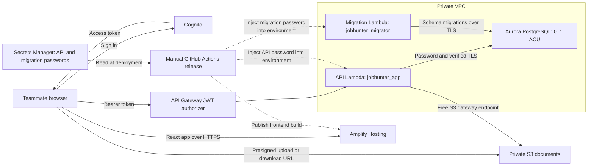

# AWS deployment handoff

Updated 21 October 2026. The foundation, backend and website are deployed. The password-authentication transition and release succeeded on 21 October 2026; the transition instructions below are for recovery or a new environment. Singapore (`ap-southeast-1`) is the target region; use Amplify's provided address.

## Architecture and credentials

Solid arrows show application traffic or credential retrieval. Dashed arrows show deployment configuration. The Lambda functions read database passwords from their environment, so they do not contact Secrets Manager at runtime. There is no NAT gateway or paid Secrets Manager VPC endpoint. The master password is used only by the operator bootstrap and is omitted from the normal release path.

| Location | What is stored there | Who can obtain it |
|---|---|---|
| Secrets Manager, Singapore: AWS-managed `rds!cluster-…` secret | Master `jobhunter_admin` password for setup/recovery | Authorized AWS operators; normal release role cannot read this secret |
| Secrets Manager, Singapore: `jobhunter-staging-database-credentials` | Separate `jobhunter_app` and `jobhunter_migrator` passwords in one JSON secret | Authorized AWS operators and the GitHub release role |
| Each Lambda's environment configuration | That function's own `DATABASE_PASSWORD`, encrypted at rest | Function code and AWS principals with sufficient configuration-reading permissions |
| Terraform state and saved plans | Can contain copies of Lambda environment passwords after refresh | Principals who can read the private state bucket or local plan/state files |
| Git repository and GitHub deployment variables | Architecture, scripts, resource names and secret ARN; no password values | Repository collaborators |

**After pulling:** read this file for the architecture. Use the local Docker setup for development; no production credentials are needed. Cloud deployment uses **Actions → Deploy staging → Run workflow → main**; ordinary merges do not deploy. Database changes belong in Alembic migrations. Password rotation is separate operator work, not part of normal feature development.

**Trust boundary:** pulling the repository alone does not grant secret access. However, maintainers who can change and execute the deployment workflow on `main` can potentially retrieve credentials through its AWS role. Treat those maintainers, Lambda configuration readers and Terraform-state readers as trusted secret holders. An ARN is an identifier, not a password.

## First-release design

| Service | Purpose and report justification |
|---|---|
| Amplify Hosting | Serve the React build over HTTPS without operating a VM or purchasing a domain. |
| Cognito | Separate user accounts, managed login and access tokens; public browser client with authorization code/PKCE. Team-only access through operator-created accounts; no public sign-up or social login. Website users do not need IAM accounts. |
| API Gateway and Python Lambda | Reuse FastAPI and existing resume/PDF features; request-driven execution with concurrency and request limits. |
| Aurora PostgreSQL Serverless v2 | Keep the existing relational schema, Alembic migrations, pgvector and tenant RLS. Configure 0–1 ACU and auto-pause after 30 idle minutes for intermittent project use. PostgreSQL compatibility reduces future migration work, but moving to standard RDS still requires data transfer and a tested cutover. |
| Private S3 | Durable uploads and exports across Lambda replacements; versioned files and short-lived signed URLs. |
| Password database authentication | Separate API and migration credentials, retrieved by the release runner and injected into Lambda configuration. No runtime Secrets Manager request or paid interface endpoint. IAM database login is denied by this account’s organization policy. |
| GitHub Actions / ECR / Terraform | Test and publish immutable application artifacts; use GitHub OIDC instead of stored AWS keys. Terraform provisions infrastructure separately from application releases. |

The private database spans a two-subnet network with one serverless writer. There is no NAT gateway, VM or paid interface endpoint. A free S3 gateway endpoint provides document access. External AI/model calls and embedding workers are deferred.

## Implemented locally

- Cognito browser login/callback/logout and bearer-token API calls; trusted API Gateway JWT claims mapped to internal users with transaction-local tenant isolation.
- Lambda image/ASGI handler, existing PDF fonts, S3 uploads with authenticated finalize and version-pinned reads/deletion.
- Terraform foundation plus an opt-in backend (`enable_backend=false` by default), scoped IAM permissions and budget alerts.
- Password connections with verified TLS and the bundled public RDS CA certificates. No idle connection pool keeps Aurora awake; bounded connection retries cover resume delays.
- A dedicated migration function using an administrator SQL identity and advisory lock. The API uses `jobhunter_app`, without superuser or RLS bypass privileges.
- GitHub release workflow and scripts for migrations, API updates, frontend publication and public configuration. The password-based release passed migrations, API health/anonymous-access checks and Amplify publication. Browser acceptance with separate team accounts remains a separate check.

The master password remains AWS-managed for operator recovery. A second Secrets Manager secret holds separate `jobhunter_app` and `jobhunter_migrator` passwords; only the operator and release role retrieve it outside the VPC. Lambda receives the relevant password through encrypted-at-rest environment configuration. The API has no secret-reading permission. The migrator inherits the master SQL role for existing schema ownership and DDL; it is privileged and never handles HTTP requests.

**State security:** credentials are never committed, passed in shell arguments, or supplied as Terraform variables. However, Terraform refresh reads Lambda environment variables and can store their values in state and saved plans. `ignore_changes` preserves deployment-injected passwords; it does not hide them from state. Protect the private encrypted state bucket, its versions and local plans as secrets. Restrict Lambda configuration-reading access as well.

**Rotation:** generate and store new credentials, apply them to the SQL roles through the operator bootstrap, then run the release to update both functions. There can be downtime between SQL and Lambda updates. Ordinary code releases reuse the stored passwords. Keep the master out of application configuration.

## Cost model

Singapore Aurora Standard planning rates (inspected 20 October): **USD 0.20/ACU-hour**, **USD 0.11/GB-month** of consumed database storage, and **USD 0.22 per million I/O requests**. The configuration has one writer, a minimum of 0 ACU, a maximum of 1 ACU, and a 30-minute idle auto-pause interval.

**A maximum of 0.5 ACU is not supported.** AWS requires a maximum of at least 1 ACU, and the installed Terraform provider enforces that limit. USD 73/month is therefore a continuous 0.5-ACU *usage example*, not an enforceable worst-case cap. The owner selected 0–1 ACU, team-only access and a notification-only alarm after this was verified.

| Compute usage | Approximate USD |
|---|---:|
| 0.5 ACU for 80 active hours | 8.00 |
| 0.5 ACU continuously for 730 hours | 73.00 |
| 1 ACU continuously for 730 hours | 146.00 |

At 20 GB average consumed storage, add approximately USD 2.20/month; 10 million I/O requests add USD 2.20. These are examples, not preallocated storage or I/O allowances. Two secrets (master plus deployment credentials) add approximately USD 0.80/month, plus API requests. Hosting, requests, logs, the CloudWatch alarm/SNS, backups beyond allowances, transfer and taxes are additional. Compute is uncharged while actually paused, but storage continues to be billed. 30-minute idle intervals, resume activity and administrative/maintenance work can contribute to compute usage. The 1 ACU ceiling limits capacity, not the whole account bill.

Deployment-injected passwords avoid the approximately USD 9.49/month Secrets Manager interface endpoint. Secrets Manager storage is still used: one master secret and one combined API/migration credential secret, approximately USD 0.80/month total plus requests. No NAT gateway or paid interface endpoint is needed.

There are two independent notifications:

- **Monthly budget:** USD 40 by default, with actual-spend alerts at 80% and 100% (USD 32 and USD 40), once per threshold per monthly period. No forecast alerts or scheduled report emails. These notify; they never stop resources.
- **Aurora activity:** a CloudWatch alarm on the writer's `AWS/RDS` → `ServerlessDatabaseCapacity` metric, using hourly `Maximum > 0`, **12 of the last 24 periods**, with missing samples treated as non-breaching. Any activity within an hour counts that hour, so intermittent team testing spread across 12 hours can legitimately trigger it. The alarm reads published metrics and does not open a database connection. An SNS email is sent when it enters ALARM; no OK-state or repeating daily email action is configured. It can notify again after clearing and later re-entering ALARM. Evaluation and metric delivery can be delayed; this is not an exact runtime counter or spend limit.

Configure `activity_alert_emails` in an untracked tfvars file for the team, or leave it empty to reuse `budget_alert_emails`. Enabling the backend without any recipients fails its plan precondition. Each recipient must confirm the SNS subscription email after an approved rollout. Recipients are not public frontend build variables. No notification has been sent and no subscription has been created locally.

**There is no automatic kill switch or pause/status Lambda.** A busy team day alerts the team rather than taking the API offline. Manual pause/resume is available through the GitHub workflow below. Investigate capacity, `DatabaseConnections`, Lambda/API activity and application logs when alerted. Existing in-flight work, migration functions and open administrator sessions are separate from API traffic.

Confirm the total budget currency, remaining credits and expiry before deployment. For the report, compare measured ACU-hours, storage/I/O, other service charges and credits separately. Justify Aurora for intermittent project use and measure its actual idle savings; do not claim it has a fixed USD 73/month cap or is always cheaper than provisioned RDS.

## CI and manual deployment

Merging to `main` **does not deploy**. The release workflow has only `workflow_dispatch` and rejects other branches. After reviewing checks, choose **GitHub → Actions → Deploy staging → Run workflow → main**. Every manual release reruns frontend tests/build, backend/PostgreSQL tests, migrations and HTTP smoke checks, script regressions, and the production ARM64 image packaging check before updating Lambda. The image can be built/pushed while the API function is absent, preserving the foundation bootstrap sequence. No AWS deployment runs from a PR.

CI runs for PRs targeting `main` and pushes to `main`, avoiding duplicate branch-push/PR runs. Older runs of the same PR are cancelled. A small Git-path selector filters PR jobs by frontend/backend/scripts changes; docs-only PRs still report a final **Checks passed** status without starting application builds. Main pushes retain full frontend/backend/script checks. The expensive ARM64 package job runs only for backend or workflow changes; Docker layers are cached across CI and manual releases. Script tests run separately so script-only PRs do not need an emulated Lambda build. Unknown or missing Git history runs all checks rather than skipping coverage.

The final **Checks passed** job fails if any selected dependency fails or is cancelled. Workflow changes run all checks. Action SHA pinning, OIDC workflow-specific trust and repository branch-protection settings remain separate hardening tasks; no GitHub settings were changed locally.

## Manual backend pause and resume

After review, deployment-variable configuration and merging the workflow to `main`, open **GitHub → Actions → Pause or resume staging backend → Run workflow**. Select branch `main` and mode `pause` or `resume`.

- **Pause:** sets only the API Lambda's reserved concurrency to **0**, blocking new API executions. Aurora can auto-pause after the existing work/connections drain and the 30-minute idle interval elapses. This does not directly stop the database, interrupt every existing session, disable Cognito/Amplify, or remove storage charges. `/v1/health` is still database-free, but it cannot execute while its API Lambda is paused; expect API errors during a deliberate pause.
- **Resume:** restores reserved concurrency to **10**, never unlimited concurrency. The next signed-in request can resume Aurora through the existing bounded `/me` gate. No activity-alarm state automatically enables or disables the API.
- The workflow is manual-only, uses GitHub OIDC and is restricted to `main`. It shares the `staging-release` concurrency group with deployment so the two workflows do not run simultaneously. It verifies the resulting API reservation through `GetFunction`.
- The release role gains only `lambda:PutFunctionConcurrency` on the **API function ARN** for these controls; its existing `GetFunction` read permission supplies verification. It cannot change concurrency on the migration function or remove the reservation to allow unbounded concurrency.
- Terraform creates the API at 10 but ignores later reservation changes, preserving a manual pause across infrastructure updates. Normal backend releases check for reservation 0 **before running migrations** and fail without deploying while paused. After resuming, manually re-run `Deploy staging` to release any changes that were blocked; resuming alone does not deploy code.

The controls are defined locally and have not been run against AWS. Verify pause/resume, the deployed API reservation and actual Aurora idle behavior during the approved acceptance test.

## Connection and access guards

- Cognito is **team-only** (`allow_admin_create_user_only=true`). Operators create ordinary accounts for the six teammates and the fictional demo workspace. Anonymous API requests are rejected by the Gateway authorizer before reaching database code. No Google/social provider, SES or custom domain is configured. Cognito's built-in email sender handles invitations and managed password reset.
- Cloud connections use `NullPool`; request sessions commit/rollback and close in `finally`. Each new physical connection uses verified TLS through the bundled public RDS CA certificates. Warm Lambda instances do not retain idle database connections.
- Cloud migrations apply runtime-only role defaults: **15 seconds per statement**, **30 seconds idle in a transaction**, and **60 seconds idle outside a transaction**. They bound orphaned runtime sessions without constraining migrations/admin queries.
- Public `/v1/health` remains database-free and has a separate rate limit of 1 request/second with burst 2. API Gateway throttling is best-effort and does not reserve capacity for other routes. Do not add public SQL readiness routes, scheduled SQL probes, Lambda warmers or browser keep-alives. Frontend token renewal talks to Cognito rather than the database.
- Initial cloud entry waits for one authenticated `/me` request before the workspace sends parallel requests. Only that GET retries temporary failures, with a **45-second total deadline** and cancellation when leaving the screen. No writes or periodic wake-ups are automatically retried. API reserved concurrency remains 10 for the subsequent request burst.
- Close SQL consoles and administrator sessions after use. Review auto-pause compatibility before introducing RDS Proxy, replication or other database features. Valid or invalid connection attempts can wake Aurora; direct access is therefore private and restricted to the Lambda security group.

For acceptance, leave the app untouched and close database clients for at least 35 minutes. Observe `DatabaseConnections` and `ServerlessDatabaseCapacity` through CloudWatch/RDS metrics and confirm they reach zero after idle. Checking with SQL would wake the database. Verify that a tab left open without edits produces no API keep-alive traffic. Test a real resume, password connectivity, memory headroom and PDF/import workloads at the configured ceiling. No scheduled shutdown or hard spending limit is configured.

## Before deployment

1. Complete the independent review of the current working tree, especially password bootstrap, migration ownership, tenant RLS and signed file access.
2. Verify signed-download navigation, Gateway CORS and API rollback in AWS; local implementations and recovery tests are present.
3. Pin workflow actions and review the GitHub OIDC trust boundary. CI now builds the production ARM64 Lambda image on PRs; release image publication also works before the backend functions exist.
4. Bootstrap the S3 state backend (see Terraform state). Merges to `main` run checks only. Deploy by running **GitHub → Actions → Deploy staging → Run workflow**, selecting `main`. Terraform applies remain a separate reviewed operation.
5. Supply the user's budget alert email and require alerts before enabling paid infrastructure. Review S3/ECR retention without deleting document versions still referenced by the database.
6. Review a full Terraform plan and refreshed cost estimate. No apply is authorized yet.

## Terraform state

State lives in a private, versioned, encrypted S3 bucket (`jobhunter-<account>-tfstate`) created by the separate `infra/state` stack. The bucket has `prevent_destroy`, so app teardown never deletes it. Copy each `*.example` file (`terraform.tfvars`, `backend.hcl`, and for the first run `infra/state/bootstrap_override.tf`) to its real name; the real files are gitignored. The state owner is the operator who runs the applies.

1. First bootstrap only: with `infra/state/bootstrap_override.tf` present, `terraform -chdir=infra/state init`, `plan`, then `apply` to create the bucket using local state.
2. Delete `infra/state/bootstrap_override.tf`, then `terraform -chdir=infra/state init -migrate-state -backend-config=backend.hcl` to move the bucket's own state into it. Delete the leftover local `terraform.tfstate*` files only after `terraform -chdir=infra/state plan` shows no changes.
3. `terraform -chdir=infra/aws init -backend-config=backend.hcl` (add `-reconfigure` if it was previously initialized without a backend). Every later plan/apply of the app stack reads and locks state in S3.

## Initial rollout after review

1. Provision the foundation to obtain the Amplify origin, Cognito configuration, ECR repository and release role.
2. Configure the foundation deployment variables and manually run **Actions → Deploy staging → Run workflow** on `main`. It builds/pushes the ARM64 Lambda image even before the backend functions exist and records the immutable digest in the Actions run summary. Use that digest as `api_image_uri` when planning the backend.
3. Provision the reviewed backend. Read `terraform output -json database_bootstrap` for the migration function and managed administrator secret ARN; these are identifiers, not passwords.
4. With an authorized operator session and Python/boto3 installed, run `AWS_PROFILE=nus AWS_DEFAULT_REGION=ap-southeast-1 python scripts/bootstrap_database.py --function <migration-function> --secret-arn <master-secret-arn> --credentials-secret-arn <deployment-secret-arn>`. Do not copy secret values into source, shell arguments, Terraform variables or logs. Verify a subsequent normal password migration before releasing the API.
5. Export only the whitelisted public deployment values using `scripts/configure_github_deploy.py`; release the frontend/API through the checked workflow.
6. Test two real accounts for login/logout, expiry, profile persistence, PDF/DOCX import/export, cross-user denial and persistence across Lambda replacements. Measure the first request after Aurora pauses and verify the bounded wake-up screen; exceptionally long resumes may still require a manual retry. Confirm actual auto-pause and costs.
7. Create an ordinary shared Cognito demo user containing fictional data. Share its password privately; use individual accounts for personal work and university SSO for infrastructure access.

Local verification is not proof of password login, Aurora resume, organization permissions or browser behavior in AWS. Those remain rollout acceptance checks.

Local checks after release hardening: **632 backend tests**, **244 frontend tests**, the production frontend build and the release/control script tests passed. The ARM64 Lambda image built and passed handler/certificate/font packaging checks; recovery tests also passed inside that image. Terraform validation passed. The earlier disposable PostgreSQL migration check passed using the supplied-connection path. These do not substitute for the cloud acceptance checks above.

## References

- [IAM database authentication](https://docs.aws.amazon.com/AmazonRDS/latest/AuroraUserGuide/UsingWithRDS.IAMDBAuth.html): token lifetime, authentication precedence and memory overhead.
- [IAM database policy scoping](https://docs.aws.amazon.com/AmazonRDS/latest/AuroraUserGuide/UsingWithRDS.IAMDBAuth.IAMPolicy.html): use the cluster resource ID and SQL username.
- [Aurora capacity limits](https://docs.aws.amazon.com/AmazonRDS/latest/AuroraUserGuide/aurora-serverless-v2.setting-capacity.html): the maximum must be at least 1 ACU.
- [CloudWatch alarm notifications](https://docs.aws.amazon.com/AmazonCloudWatch/latest/monitoring/AlarmThatSendsEmail.html): alarm evaluation and state-change actions.
- [Aurora auto-pause](https://docs.aws.amazon.com/AmazonRDS/latest/AuroraUserGuide/aurora-serverless-v2-auto-pause.html): availability, idle connections, resume behavior and capacity billing.
- [Aurora pricing](https://aws.amazon.com/rds/aurora/pricing/): refresh Singapore prices before approval.
- Existing [cloud handoff](CLOUD-DEPLOYMENT-HANDOFF.md), [Lambda notes](LAMBDA-NOTES.md) and [portability rules](LOCAL-TO-AWS.md) contain earlier proposals; they do not establish deployed resources.

## Release hardening review status

- **H1:** S3 downloads return uncached `{url}` JSON after ownership checks; the browser navigates directly to the signed HTTPS address. Local downloads still return blobs. No API bearer token is sent to S3.
- **H2:** Synchronous migration Invoke uses a 330-second client timeout and one total attempt. The function timeout remains 300 seconds.
- **H3:** API Gateway has the exact Amplify origin, allowed methods and authorization/content-type headers configured. The unauthenticated OPTIONS route is retained for the authorized default route. Cloud error messages distinguish expiry and throttling; verify generated 401/429 headers in AWS.
- **M2:** Failed API update/checks trigger recovery to the recorded immutable image digest, guarded by the Lambda revision and current digest. Recovery is checked and the release fails, preventing frontend publication. Recovery failures are explicitly reported. Applied schema migrations remain in place, so releases require backward-compatible migrations. This does not implement automatic recovery from a later frontend publication failure.
- **M8:** PR checks build the actual ARM64 Lambda Dockerfile, import both handlers and verify packaged certificates/fonts. Release recovery unit tests run in that image.
- **M1:** The verified creation version remains 16.15 with `ignore_changes = [engine_version]`, preventing a later apply from attempting to undo automatic maintenance. Deliberate upgrades require reviewing that lifecycle rule.
- **M5:** Image build/push is gated by ECR availability rather than API function existence. The foundation release can therefore produce the first image; deploying the paid backend still requires the reviewed Terraform apply and explicit database bootstrap.

## Password transition from the IAM deployment

1. Review and apply the Terraform change: disable cluster IAM login, configure password mode and the dedicated migrator, create credential-secret metadata, and authorize the release runner. No endpoint or database replacement is needed. Wait until the cluster reports IAM authentication disabled; the change can wait for the maintenance window unless explicitly applied immediately.
2. Update only the migration Lambda to the tested new image before invoking the new bootstrap. The old handler grants IAM roles and must not be used for this transition.
3. Run `scripts/bootstrap_database.py` with the master secret and deployment-secret ARNs. It generates passwords only if the deployment secret has no value, persists them before SQL changes, removes `rds_iam` membership and initializes the roles/schema. Reruns reuse the same passwords. If master login remains blocked, stop and request administrator recovery; do not replace the database.
4. Publish `terraform output -json deployment` through `scripts/configure_github_deploy.py`, then run **Deploy staging** on main. It injects the migration password before migrations and the runtime password before updating the API image.
5. Verify an authenticated two-account workflow, PDF downloads and Aurora idle behavior. The public health check alone does not prove database login.

## Responsiveness tuning

Applied on 21 October 2026: Terraform raises the shared authenticated API throttle to 20 requests/second with burst 40, keeps the health route at 1/second with burst 2 and retains API Lambda concurrency at 10. These are shared limits, not per-user quotas. Aurora's idle auto-pause interval is 30 minutes (1,800 seconds), trading some additional idle compute for fewer wake-ups during team testing. For example, an extra 25 idle minutes at 0.5 ACU adds about USD 0.042; capacity and workload affect actual usage. The deployed API Gateway stage and Aurora scaling configuration were verified after apply.

The frontend changes currently under local review share concurrent identical reads within the same identity, invalidates shared reads when a write starts, and gives cancellable calls their own request. Writes are never combined or automatically repeated. Profile content renders independently of resume-source/import-history loading. Import from file accepts PDF/Word and opens review after upload; JSON backup actions are under Profile backups.
