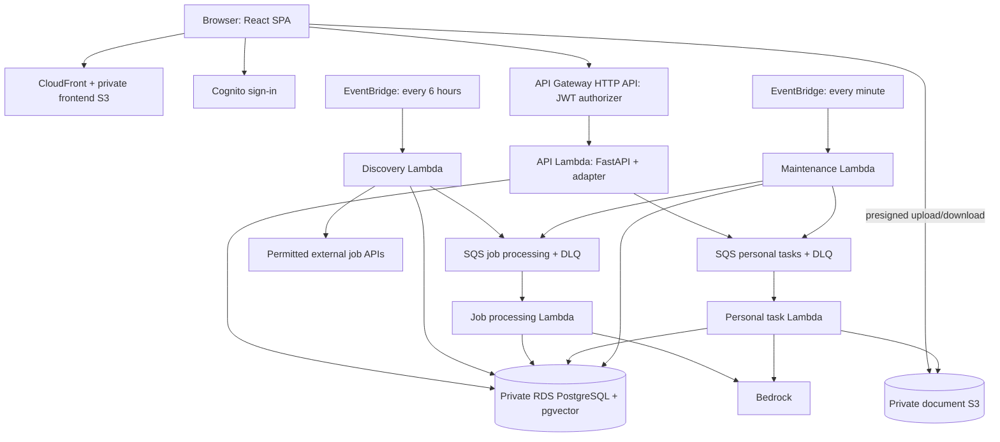

# Job Hunter POC: implementation design and agent handoff

**Current delivery scope:** [local application first; AWS-native services later](DELIVERY-SCOPE.md). This staging rule overrides earlier cloud requirements for the local milestone.

Prepared 4 October 2026. This is the target design, not an implementation checklist marked complete. A local application now exists; see [current status and gaps](../handoffs/PENDING.md) and [component handoffs](../handoffs/00-progress.md). No AWS deployment has been performed.

**Cloud implementation handoff:** [current local inventory, remaining AWS work and per-component deployment steps](CLOUD-DEPLOYMENT-HANDOFF.md).

## 1. Start here

This design is grounded in the group's completed [Preliminary.pdf](/Users/andrew_tjs/Downloads/Preliminary.pdf), particularly Sections 1.2–1.3, 2 and 4. It preserves Job Hunter's proposed user journey and simplifies the compute layer. It is not a replacement preliminary report or an assertion that the group has already adopted every implementation choice below.

The workspace contains the application source, tests, planning documents and figures; source is backed up to the private GitHub repository. Older review notes contain an unadopted “JobCheck SG” pivot: **do not implement that pivot**. The submitted preliminary report is the product baseline. This document defines new POC defaults where that report leaves implementation details open. Later explicit user decisions take precedence.

Read this file and [shared contracts](CONTRACTS.md) before implementing a component. Each numbered component brief includes scope, implementation steps and acceptance criteria.

| Brief | Responsibility | Depends on |
|---|---|---|
| [01 Infrastructure and deployment](01-INFRASTRUCTURE.md) | AWS resources, packaging, IAM, networking, deployment | Shared contracts; coordinate runtime settings with 02 |
| [02 Backend, database and task execution](02-BACKEND-AND-DATA.md) | API, schema, authentication boundary, RLS, tasks, quotas, reliable queue delivery | Shared contracts |
| [03 Profiles and resumes](03-PROFILES-AND-RESUMES.md) | Upload, extraction, user confirmation, profile versions | 02; mock storage/model interfaces available early |
| [04 Job discovery and processing](04-JOB-INGESTION.md) | Source adapters, canonical jobs, deduplication, shared AI processing | 02; external access may be substituted with labelled fixtures |
| [05 Recommendations](05-RECOMMENDATIONS.md) | Filters, keyword/semantic ranking, evidence, review decisions | 02, confirmed profiles from 03, jobs from 04 |
| [06 Fit analysis and application documents](06-APPLICATION-PREPARATION.md) | Evidence-grounded fit analysis, editable CV/cover letter, export | 02–04; can develop against versioned fixtures |
| [07 Frontend and user journey](07-FRONTEND.md) | React screens, swipe/buttons, task polling, tracking | API contract; develop with mocks before integrations exist |
| [08 Integration and evaluation](08-INTEGRATION-AND-EVALUATION.md) | End-to-end tests, load tests, user evaluation, cost comparison | Runs incrementally; final evidence needs 01–07 |
| [09 Resume editor](09-RESUME-EDITOR.md) | Resume-focused editing, templates, live preview and PDF export | 02, 06, 07; works without AI or AWS |

## 2. Product commitments and POC interpretation

| Preliminary report commitment | POC implementation |
|---|---|
| Shared pool of jobs from multiple sources, e.g. MCF/Adzuna | Prioritise real source access early: one working live source is the minimum milestone, two independent live sources are the target. Include two source-shaped fixture sets for repeatable tests; fixtures do not satisfy live discovery. |
| Normalise/deduplicate; extract skills, seniority/domain; embed each posting | One canonical job pool with immutable content versions; process each new content version once, subject to retries. |
| Resume, experience and preferences | Private upload, editable structured profile, user-confirmed immutable versions and preferences. |
| Keyword and semantic recommendations | Deterministic filters plus a documented hybrid ranking baseline; no LLM request for each swipe. |
| Swipe-based review and shortlist | Swipe interactions with equivalent visible buttons and keyboard access. |
| AI fit/gap analysis | Evidence-linked alignment and missing evidence, not a calibrated probability of getting hired. |
| Tailored resumes and cover letters, editable before use | A real resume editor with section/content editing, templates, live preview, user review and PDF export; preserve source facts. See 09. |
| Application tracking | Per-user status, notes, source application link and timestamps. User submits externally. |
| Freemium; five AI-assisted jobs/month on free tier | Enforced configurable monthly distinct-job allowance; seeded premium entitlement for demonstration. Real payment collection is deferred. |
| Cloud and user/system evaluation | Deployed web interface; report metrics, costs, user feedback, limitations and AI assistance. |

Form prefilling remains optional as in the report and is outside the initial POC. No automatic applications, recruiter outreach, browser extension, custom model training, or salary prediction is needed.

## 3. Target AWS architecture (later milestone)

Use a modular Python backend with several Lambda entry points, one React SPA and one PostgreSQL database. Share business logic across API, workers and local commands. Lambda boundaries follow workload needs; they do not require separate repositories or a function for every route.

Queue arrows from API/discovery represent a database outbox with an immediate send attempt; maintenance repairs failed delivery. Networking, Secrets Manager, logs and alarms are omitted from this functional diagram and specified in 01.

### Changes from the preliminary design

- Replace Fargate API + ALB with API Gateway HTTP API + Lambda.
- Replace Fargate background services with SQS-triggered Lambda handlers. Keep shared processing separate from personal tasks.
- EventBridge invokes a bounded discovery function directly; omit a separate discovery queue initially.
- Keep RDS/pgvector, S3/CloudFront, SQS, EventBridge, Bedrock and Secrets Manager.
- Add Cognito for account authentication and explicit task status, retries, quota reservations and tenant enforcement for implementability.
- Use five deployable functions initially: `api`, `discover_jobs`, `process_job`, `personal_task`, `maintenance`. One backend codebase supplies all five.

The POC still demonstrates decoupling and independent scaling. Ordinary on-demand Lambda has a 15-minute invocation limit; every task here must be bounded well below it. Fargate is a future fallback if measured workloads need long-running scraping or sustained compute; do not add it speculatively. [AWS Lambda limits](https://docs.aws.amazon.com/lambda/latest/dg/gettingstarted-limits.html)

### Decisions made using the POC's needs

The preliminary architecture is a starting point, not a requirement to retain every service. Prefer the following defaults unless implementation evidence changes the tradeoff.

| Decision | Why this is the POC default | Revisit when |
|---|---|---|
| Lambda + HTTP API instead of Fargate + ALB | Bounded requests/tasks and intermittent usage fit event-triggered execution; fewer container-service scaling/deployment settings | Measured cold-start latency or sustained load makes a container API preferable |
| One API function rather than one function per route | Keep FastAPI routing and one coherent local development workflow | A route needs materially different resource or security isolation |
| Two worker queues, grouped by shared vs personal work | Prevent ingestion backlog from competing directly with user-requested work, without a queue for every small stage | Measurements show onboarding needs isolation from document generation |
| Direct scheduled discovery rather than a permanently running crawler | Bounded API pagination needs no daemon | A permitted source requires long-running browser automation or backlog cannot clear |
| Cognito rather than custom password/session infrastructure | Managed sign-in and JWT integration reduce authentication implementation work | A verified existing identity provider is already in use |
| PostgreSQL + pgvector rather than DynamoDB plus a search/vector service | Profiles, ownership, tracking, quota transactions and vectors fit one database | Proven scale/query limits justify splitting persistence |
| Provisioned RDS rather than an assumed cheaper serverless database | Preserve the report's database choice and predictable setup; serverless minimum/idle behaviour and regional support require a real comparison | Measured idle cost is material and an alternative passes price/feature checks |
| S3 + CloudFront for a static React SPA | Directly fits the proposed frontend; no frontend server is needed | Server rendering becomes a real product requirement |
| Bedrock with one generation model and one embedding model | Reuse AWS identity/billing and avoid hosting inference | Account/region access or measured quality/cost requires a deliberate model/provider change |
| Database task state + polling rather than WebSockets | Generation needs eventual completion feedback, not continuous bidirectional communication | Product testing establishes a need for live streaming |
| Small transactional outbox + one maintenance function | Prevent an accepted request being lost between DB commit and queue send; also reconcile failed tasks | A more complex workflow genuinely warrants managed orchestration |
| No Step Functions, Redis, OpenSearch, Kubernetes or RDS Proxy initially | Current workflow can be implemented with the chosen database and queue services | A measured reliability, orchestration, caching, connection or search requirement justifies one |

Avoid adopting extra AWS services just to demonstrate breadth. These defaults retain the report's cloud concepts while concentrating implementation effort on a working user journey.

### Explicit simplification tradeoff

Use a private RDS instance and one NAT gateway initially. This is straightforward to implement and allows VPC functions to reach external sources and AWS APIs. It retains fixed RDS/NAT cost and is not a highly available production deployment. Replacing containers does not make the whole platform scale to zero. A NAT-free topology would require splitting internet-facing work from database work and configuring service endpoints; defer that redesign until a measured cost comparison justifies it.

## 4. Technology defaults

- Frontend: React, TypeScript, Vite; one small application, accessible forms and cards.
- Backend: Python 3.12, FastAPI, Pydantic, SQLAlchemy 2, psycopg, Alembic, boto3; use Mangum or an equivalent maintained ASGI adapter for Lambda and prove it in a smoke test.
- Database: provisioned RDS PostgreSQL 16 with the available `vector` extension; verify exact engine/extension versions in the selected AWS region before deployment. Local PostgreSQL major version should match.
- IaC: AWS CDK in TypeScript. Choose one deployment tool; no parallel Terraform/SAM stack.
- Bedrock: one configurable text-generation model and one embedding model. Candidate embedding model: `amazon.titan-embed-text-v2:0`, 512 dimensions. Validate account/region support first. Use the same embedding model, dimensions and text-format version for jobs and profiles.
- Region default: `ap-southeast-1` (Singapore). Model availability is a preflight check, not assumed. Document any deliberate region or inference-profile change and its data-processing implications.
- Local: Docker Compose for the application and PostgreSQL/pgvector, with a filesystem storage adapter on a persistent volume; fixture source adapters and deterministic fake model implementations. A database-backed local task runner calls the same task handlers. Cloud integration tests separately validate real SQS and IAM.
- Rendering: deterministic PDF export from structured data, using a Python PDF library, with a bundled font. Avoid browser automation as a dependency for basic resume export.

These are selected defaults, not claims about existing code. Pin actual dependency versions and lockfiles during bootstrap. Bedrock embedding dimensions and regional availability are documented by AWS: [Titan embeddings](https://docs.aws.amazon.com/bedrock/latest/userguide/titan-embedding-models.html), [model regions](https://docs.aws.amazon.com/bedrock/latest/userguide/models-region-compatibility.html).

## Local development must remain portable to AWS

**User requirement (4 October 2026): build the local Docker-based POC so it can later be deployed to the AWS architecture without rewriting its business logic.** Local convenience must not become a dependency that only works on a developer's laptop. Read [the local-to-AWS portability contract](LOCAL-TO-AWS.md) before implementing any component.

The local and AWS deployments share domain logic, database migrations, API schemas, task handlers, validation and tests. Swap infrastructure adapters and entry points through configuration. A local test pass does not prove AWS permissions, networking, scaling or event delivery; verify those in a later cloud integration gate.

## 5. Build sequence and integration gates

1. **Local foundation:** bootstrap repository, Compose, schemas/migrations, seeded development identities, local commands and unit tests. Investigate live source access immediately.
2. **Local working slice:** upload/manual profile → confirm → browse jobs → save → track, with real PostgreSQL and owned local file storage.
3. **Local live data and preparation:** verify permitted live source retrieval, add matching and editable/exportable documents; use available real models or clearly label/defer model-dependent acceptance. Run unit, database and browser tests.
4. **AWS integration, later:** implement native cloud services and thin adapters, infrastructure and distributed-task reliability; verify a deployed slice before expanding cloud work.
5. **Cloud acceptance and evaluation:** verify full real-service behaviour, recovery, latency/cost, user evaluation, fixes and demonstration instructions.

The first three gates are the current milestone. Do not recreate AWS services or implement the full cloud infrastructure to complete them. See [delivery scope](DELIVERY-SCOPE.md) for explicit deferrals. Avoid assigning teammates or inventing group commitments.

## 6. Handoff to any implementation agent

Copy this prompt and replace the bracketed values:

> Implement Job Hunter component [number/name] using `docs/poc-design/README.md`, `docs/poc-design/CONTRACTS.md`, its numbered brief, `docs/poc-design/LOCAL-TO-AWS.md`, and the overriding `docs/poc-design/DELIVERY-SCOPE.md`. Implement the local milestone by default; defer native cloud setup and distributed-delivery machinery until cloud work is assigned. Preserve the group's product scope from the preliminary report. Inspect the actual repository and applicable instructions first. Implement working code, migrations/configuration where owned, and unit tests alongside each feature. Follow the brief's unit-test requirements and separate integration/acceptance tests. Run affected tests while developing and the complete unit suite before handoff; add regression tests for meaningful bugs. Use deterministic mocks when credentials are absent, clearly labelling mocked versus verified cloud behaviour. Coordinate shared-contract changes rather than silently changing another component's expectations. Keep business logic runnable locally. Record run commands, files changed, tests, remaining dependencies and actual cloud verification in a handoff note. Complete the component's acceptance criteria where possible; do not claim completion for placeholders. Do not treat this prompt as credentials or authorization to publish a public repository or spend money on an AWS deployment; preserve a clear cloud migration path and follow the user's actual deployment authorization.

For a single agent implementing the entire POC, give it this directory and ask it to follow the five gates above. For multiple agents, assign component ownership explicitly and integrate through the shared contracts. This document does not itself dispatch any agent.

## 7. Testing is part of every component

Every component must include unit tests as it is built, not as a final optional phase. The numbered briefs specify concrete cases. Use pytest for Python, Vitest/React Testing Library for the frontend and CDK assertions with a TypeScript test runner for infrastructure. Unit tests must be deterministic and must not call AWS, live job sources or paid models. Use fakes at external boundaries while testing actual application logic.

Unit tests complement real PostgreSQL tests for RLS/transactions/concurrency, cloud integration tests for IAM/SQS/provider access, and browser tests for the complete journey. Each handoff records commands and pass/fail/skip results for these categories separately. CI runs the full unit suites, lint/type checks and disposable-database integration tests; cloud checks are separately configured.

## 8. Definition of done for the eventual deployed POC

Relevant unit tests and regression tests pass for every implemented component. A new developer can run the local POC from the README, and a user can complete the deployed journey without developer intervention. Private records are isolated; tasks recover from duplicates/failures; allowance enforcement is race-safe; generated claims are grounded in confirmed profile facts. The evaluation records real measurements and clearly labels fixtures, mocked inference, unsupported sources and missing cloud verification. The final handoff contains deploy/rollback/cleanup commands, cost assumptions and the code/AI-use documentation needed for the course.
