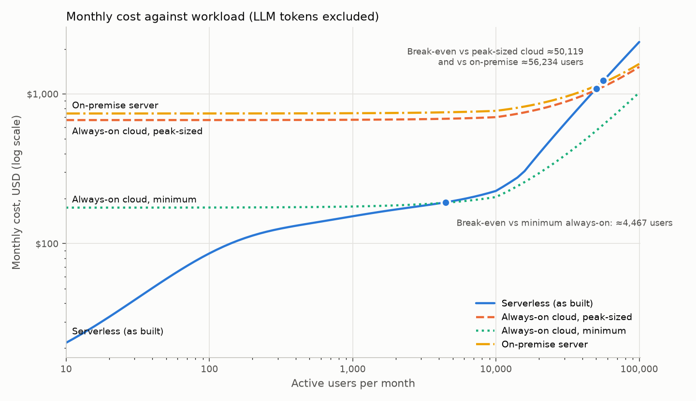

# B5 notes: cost efficiency

## Actual spend (Cost Explorer, 1–25 October 2026)

**USD 2.63 in total**: Aurora (RDS) 2.19, tax 0.22, Secrets Manager 0.11, CloudWatch 0.05, Cost Explorer queries 0.03,
ECR 0.02, API Gateway, S3 and Amplify under 0.01 each; Lambda, Cognito, SQS and SNS at zero (free tier). The
database is 83% of the bill, and it bills only while awake: auto-pause kept it paused 51 of 73 measured hours (A6).
Daily figures by service: `cost-explorer-daily-20261001-20261025.json`. (B1–B3 load tests on 25–26 October will
appear in Cost Explorer a day later; the raised-capacity window ran 29 minutes at up to 4 ACU, about USD 0.40.)

## Projected monthly cost (`eval/cost_model.py`; USD, AWS incl. 9% GST)

| | 10 users | 100 | 1,000 | 10,000 | 100,000 |
|---|---|---|---|---|---|
| **Serverless, as built** | **22** | **86** | **152** | **225** | **2,226** |
| of which Aurora | 17 | 76 | 131 | 149 | 994 |
| LLM tokens, SoClaaS (NUS) | 0 | 0 | 0 | 0 | 0 |
| LLM tokens at Nova Lite list price | 0.01 | 0.10 | 0.98 | 9.84 | 98 |
| LLM tokens at Claude Haiku 4.5 list price | 0.14 | 1.39 | 14 | 139 | 1,389 |
| Always-on cloud, minimum (t4g.medium + db.t4g.medium) | 174 | 174 | 177 | 205 | 1,022 |
| Always-on cloud, peak-sized (3 × c7g.xlarge + ALB + db.m7g.large) | 669 | 670 | 672 | 700 | 1,517 |
| On-premise server (3-year amortised) | 741 | 741 | 744 | 772 | 1,589 |

**Break-even:** serverless stays cheaper than the smallest always-on deployment up to about **4,500 active users**,
and cheaper than an always-on deployment sized for the B3 peak, or an on-premise server, up to about **50,000–56,000
users**. Below about 1,000 users it costs a fraction of any fixed option because the database sleeps.

## What drives the serverless cost

- **The database's awake hours, not requests.** One active user already holds Aurora at its 1 ACU floor (B1/B3), so
  cost follows how many hours someone is using the app (or a pull is running), up to 720 h. From about 1,000 users
  it is awake around the clock (USD 131–149) and only grows again when load needs more than 1 ACU (about 15,000
  users and up). Lowering the per-request database work (the B1/B3 finding about the listings) is what would move
  this line.
- **Per-request charges are small:** about USD 12 per million browse requests (API function 0.8 GB-s at the Arm
  price plus the HTTP API request).
- **Above 10,000 users, Cognito and Amplify become visible:** Cognito Lite charges USD 0.0055 per user beyond the
  first 10,000; website data transfer is USD 0.15/GB.
- **AI tasks cost little in AWS** (about USD 0.0005 per user per month in Lambda) but the API function is billed
  while it waits for a cover letter or rewrite (11 s and 4 s held in the request). LLM tokens are the larger AI
  cost at commercial prices: 5,179 input and 1,743 output tokens per user per month (one of each task).

## Fixed-capacity options

- **Always-on cloud, peak-sized** matches B3 run 2's peak (27.5 req/s needed about 11 vCPU for the API and about
  4 ACU of database): 3 × c7g.xlarge behind an Application Load Balancer and a db.m7g.large PostgreSQL instance,
  plus the hosted services every option keeps (sign-in, website, storage, logs, AI worker) and 2 hours of admin a
  month for OS patching.
- **Always-on cloud, minimum** is the smallest sensible pair (t4g.medium, db.t4g.medium). Its burstable CPU
  sustains well under the 10,000-user peak (about 3.5 req/s needs about 1.6 vCPU), so above a few thousand users
  the realistic always-on cost is between the two lines.
- **On-premise:** a Dell PowerEdge R660xs listed at RM 36,835.51 including SST with a 3-year warranty (dell.com/en-my,
  configuration per660xs20a, retrieved 26 October 2026) = USD 9,016 at the ECB rate, over 36 months = USD 250/month;
  power 250 W average × PUE 1.5 at SP Group's Q4 2026 tariff (28.59 cents/kWh + GST) = USD 67; Singtel business
  broadband with a static IP, S$267/month = USD 209; admin 8 hours/month at a S$5,000/month median sysadmin salary
  plus 17% employer CPF = USD 212; plus the hosted services kept. Not included (so on-premise is understated): rack
  space, UPS, spare parts, a second site for backups, and the staff time to install it.

## Assumptions to challenge

Per active user per month: 8 sessions of 25 requests (15 minutes each), 1 fit analysis, 1 cover letter and 1 rewrite,
2 MB of website assets per session, 5 MB stored. 95% of sessions in 16 hours a day. 60 pulls and 30 website builds a
month. Free tiers ignored except Cognito's 10,000 users. All are parameters at the top of `eval/cost_model.py`.

## Sources and dates

- AWS list prices: public price-list files for ap-southeast-1 (`pricing.us-east-1.amazonaws.com/offers/v1.0/aws/<service>/current/ap-southeast-1/index.json`),
  publication dates 11 September to 23 October 2026, downloaded 26 October 2026; EC2 from the AWS pricing page data
  (published 23 October 2026). Bedrock token prices from the same files (16 and 12 October 2026).
- Exchange rates: European Central Bank reference rates, 23 October 2026 (USD 1 = SGD 1.2785 = MYR 4.0855).
- Electricity: SP Group regulated tariff for 1 October–31 December 2026, reported 30 September 2026
  (The Star, mustsharenews.com).
- Network: Singtel business broadband sign-up page (100 Mbps static IP, S$267/month), retrieved 26 October 2026.
- Salary: NodeFlair system administrator median, retrieved 26 October 2026 (Payscale gives a lower S$3,600/month;
  using it would lower on-premise by about USD 60/month).
- SoClaaS pricing could not be checked (the NUS documentation is on the internal network); it is assumed free to the
  project. Confirm before the report.
