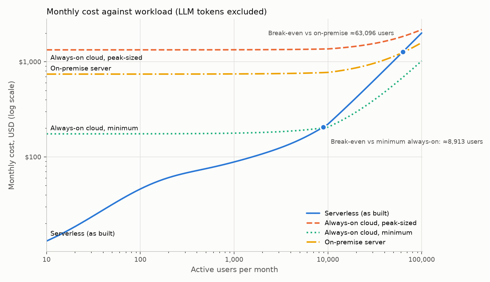

# B5 rerun: cost model with the 5 November measurements

## Actual spend (Cost Explorer)

**October 2026: USD 5.94** (Aurora 4.76, tax 0.51, Secrets Manager 0.26, CloudWatch 0.17, ECR 0.11; Lambda, Cognito,
SQS, SNS and EventBridge within the free tier). **1–4 November: USD 0.91**, with the twice-daily scheduled pulls
running. Daily figures by service: `cost-explorer-daily-20261001-20261104.json`.

## Projected monthly cost (USD, AWS incl. 9% GST)

| | 10 users | 100 | 1,000 | 10,000 | 100,000 |
|---|---|---|---|---|---|
| **Serverless, as built** (26 Oct model → 5 Nov) | 22 → **13** | 86 → **46** | 152 → **88** | 225 → **221** | 2,226 → **2,005** |
| of which Aurora | 17 → 8 | 76 → 38 | 131 → 70 | 149 → 118 | 994 → 531 |
| of which API function | 0.02 → 0.05 | 0.24 → 0.50 | 2.4 → 5.0 | 24 → 50 | 242 → 503 |
| Always-on cloud, minimum | 175 | 175 | 178 | 205 | 1,021 |
| Always-on cloud, peak-sized (now 8 × c7g.xlarge) | 1,333 | 1,333 | 1,336 | 1,364 | 2,180 |
| On-premise server | 741 | 742 | 744 | 772 | 1,588 |
| LLM tokens at Nova Lite / Claude Haiku 4.5 list price | 0.01 / 0.14 | 0.10 / 1.36 | 0.96 / 14 | 9.6 / 136 | 96 / 1,356 |

**Break-even:** serverless is cheaper than the smallest always-on deployment up to about **8,900 active users**
(4,500 in the October model), than an on-premise server up to about **63,000** (56,000), and than an always-on
deployment sized for the measured peak at every load up to 100,000.

## What changed and why

- **The database got cheaper, the functions dearer.** One active user now holds Aurora at 0.5 ACU (1 ACU in
  October), and capacity grows with the number of open connections, about 0.1 ACU per warm function instance, not
  with CPU (15–23% at 3.4 ACU in B3 run 2). The API function costs twice as much per request (2 GB instead of 1 GB,
  for the same 0.83 s): about USD 5 a month at 1,000 users and USD 50 at 10,000, against Aurora savings of USD 60 and 30.
- **The peak-sized always-on deployment is bigger** because the measured peak is bigger: B3 run 2 served 36.7 req/s
  (27.5 in October) at 0.83 s each, about 30 busy single-threaded workers, so 8 × c7g.xlarge instead of 3. The
  database for it stays a db.m7g.large (8 GiB, about Aurora's 3.4 ACU).
- **On-premise is unchanged** and still assumes one server covers the peak. The Dell configuration's CPU is not
  stated on its page, so whether one server matches about 30 busy cores is unverified.
- Inputs: B1, B2 and B3 of 5 November and the B4 scheduled pulls (1–4 November); prices as in the October model
  (AWS price lists of September–October 2026). Every input is a parameter at the top of `eval/cost_model.py`.
